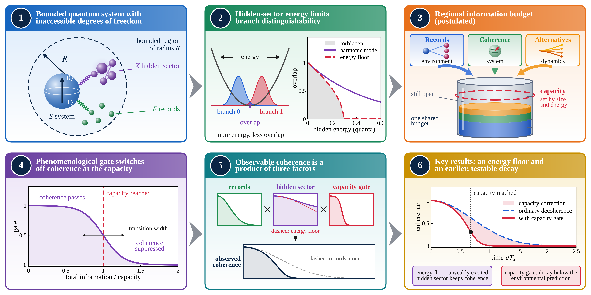

# Energy-constrained inaccessible degrees of freedom and quantum coherence in bounded systems



Code that reproduces every image, table, and figure in the following paper:

> W. Rahmaniar, *Energy-Constrained Inaccessible Degrees of Freedom and Quantum
> Coherence in Bounded Systems*, Chinese Journal of Physics.

Each number in the paper is recomputed from the models below.

## Install

```bash
pip install -r requirements.txt
```

Tested with Python 3.11, NumPy 2.x, SciPy 1.14 and Matplotlib 3.9.

## Reproduce the paper

```bash
python run_model2.py        # exact diagonalization of the three baths (~20 s)
python make_all_figures.py  # Figs. 1 to 14
python tables.py            # the numbers in Tables 1 to 3
python check_numbers.py     # every number quoted in the text
```

`check_numbers.py` prints the computed value beside the one in the manuscript
and ends with `ALL NUMBERS VERIFIED`. `make_all_figures.py` runs each figure
script in its own process, so no figure inherits another one's Matplotlib
settings; name a script to rebuild one figure, for example
`python make_all_figures.py make_fig_gates.py`. Each figure is written in the
order it appears in the paper, Fig. 1 through Fig. 14.

## Models

| File | Contents |
|---|---|
| `model_core.py` | Exactly solved central-spin dephasing model: decoherence factor, the record, coherence and future channels, and the logistic gate |
| `model_x.py` | Conditional translation of a Gaussian packet in the inaccessible sector |
| `model_xosc.py` | Hidden harmonic mode: branch overlap, hidden energy, Holevo information, energy-constrained capacity |
| `model2.py`, `run_model2.py` | Interacting baths, one XX and two XXZ chains, by exact diagonalization |
| `model2_data.py` | Stores and loads those results, `model2_results.csv` |
| `robustness.py` | Coupling sequences matched in dephasing time, and the partitioned record channel |
| `analyses.py` | Gate-form comparison, the budget-combination class, the dynamical future channel, the random-state test of the general floor, and the regime of the floor |

`figstyle.py` holds the shared plotting style.

## Tables

`tables.py` recomputes the numbers that appear in the tables. Each function
returns them as a dictionary, and running the file prints them.

| Table | Contents | Source |
|---|---|---|
| 1 | Partition dependence in the solved model | `robustness.channels_partition` |
| 2 | Dependence of the predictions on the gate form | `analyses.gate_form` |
| 3 | Regional capacity against radius and capacity energy scale | Bekenstein form, evaluated for C60 |
| 4 | Status of each result and the assumptions it carries | statement about the text, no computation |

## Data

`run_model2.py` writes `model2_results.csv`: the past, present, and future
channels of the three bath Hamiltonians on a grid of 241 times. Its header
carries the three numbers that are the same at every time, namely the spread
of the generator that separates the two branches, the dephasing time, and the
orthogonalization time. The whole run takes about twenty seconds, so the file
can be deleted and regenerated at any time.

## License

MIT, see `LICENSE`.
